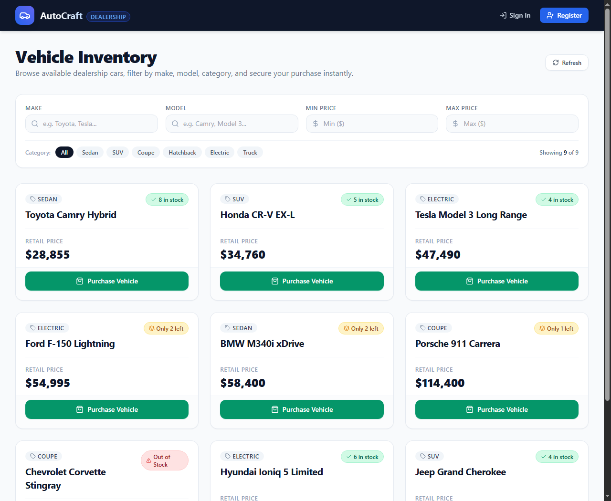

# AutoCraft — Car Dealership Inventory System

[]()
[]()
[]()
[]()
[]()

A full-stack, production-grade Car Dealership Inventory System built from scratch using strict **Test-Driven Development (TDD)** for the **Incubyte Software Craftsman Internship Assessment**.

---

## 1. Project Overview & Architecture

AutoCraft provides an automotive inventory management platform supporting customer vehicle discovery, dynamic multi-attribute filtering, concurrency-safe retail purchases, and role-based administrative catalog management.

### Key Highlights
- **Strict TDD Methodology**: Every single domain model, API route, and security check was built using the Red-Green-Refactor cycle, backed by verifiable twin Git commits.
- **Atomic Concurrency Protection**: High-throughput retail purchasing guarantees inventory never oversells or drops below zero using MongoDB conditional atomic operations (`findOneAndUpdate` with `{ quantity: { $gt: 0 } }`).
- **Clean Decoupled Architecture**: Separation of concerns between Mongoose models, service layers, controllers, middlewares, and React presentation components.
- **Secure Authentication & RBAC**: JWT-based session management, bcrypt password hashing (10 salt rounds), route-level role authorization (`user` vs `admin`), and safe CLI admin provisioning.

---

## 2. Technology Stack

| Layer | Technology | Description |
|---|---|---|
| **Frontend** | React 19, Vite, Tailwind CSS, Lucide Icons | Responsive SPA with accessible controls and live filtering |
| **Frontend Testing** | Vitest, jsdom, React Testing Library | Component interaction and state assertion testing |
| **Backend** | Node.js, Express (ES Modules) | RESTful API server with centralized error handling |
| **Backend Testing** | Jest, Supertest, mongodb-memory-server | Integration testing with isolated in-memory DB instances |
| **Database** | MongoDB with Mongoose | Document-oriented persistence with indexing |
| **Authentication** | JWT, bcryptjs | Stateless Bearer token auth with salted password hashes |

---

## 3. Application Screenshots

### Live Inventory Dashboard

*Figure 1: Responsive vehicle inventory dashboard showing vehicle cards, category badges, real-time stock levels, retail pricing, and disabled purchase button for out-of-stock vehicles.*

---

## 4. Folder Structure

```
car-dealership inventory ag/
├── backend/
│   ├── src/
│   │   ├── config/              # Database connection and environment config
│   │   ├── controllers/         # authController.js, vehicleController.js
│   │   ├── middleware/          # authMiddleware.js, roleMiddleware.js
│   │   ├── models/              # User.js, Vehicle.js (Mongoose schemas)
│   │   ├── routes/              # authRoutes.js, vehicleRoutes.js
│   │   ├── scripts/             # seedAdmin.js, seedVehicles.js, startDemoServer.js
│   │   ├── services/            # authService.js, vehicleService.js
│   │   ├── app.js               # Express application configuration
│   │   └── server.js            # Server entrypoint and MongoDB connection
│   ├── tests/
│   │   ├── setup.js             # MongoMemoryServer test lifecycle hooks
│   │   └── integration/         # auth.test.js, vehicles.test.js, purchase_restock.test.js
│   ├── .env.example
│   └── package.json
├── frontend/
│   ├── src/
│   │   ├── components/          # Navbar, VehicleCard, FilterBar, AdminModal, Alert
│   │   ├── context/             # AuthContext.jsx
│   │   ├── services/            # api.js (Fetch client with token injection)
│   │   ├── tests/               # VehicleCard.test.jsx, FilterBar.test.jsx, Alert.test.jsx
│   │   ├── App.jsx              # Main catalog dashboard and state orchestration
│   │   ├── main.jsx             # React entrypoint
│   │   └── index.css            # Tailwind directives
│   ├── .env.example
│   ├── tailwind.config.js
│   ├── vite.config.js
│   └── package.json
├── screenshots/                 # Captured application screenshots
├── .gitignore
├── INTERVIEW_PREP.md            # Technical interview preparation guide
├── PROMPTS.md                   # Raw AI interaction transcripts
├── README.md                    # Project documentation
└── TEST_REPORT.md               # Automated testing execution and coverage report
```

---

## 5. Prerequisites & Environment Configuration

### Prerequisites
- **Node.js**: `v20.x` or higher (`v24.14.0` verified)
- **npm**: `v10.x` or higher (`v11.9.0` verified)
- **MongoDB**: Local MongoDB Community Server running on `mongodb://localhost:27017` OR a MongoDB Atlas cluster URI. *(Note: Automated tests do NOT require a running MongoDB server; tests run on high-speed in-memory MongoDB).*

### Environment Variables

#### Backend Configuration (`backend/.env`)
Copy `backend/.env.example` to `backend/.env`:
```env
PORT=5000
NODE_ENV=development
MONGODB_URI=mongodb://localhost:27017/car_dealership
JWT_SECRET=super_secret_dev_jwt_key_dealership_2026_dev_mode
JWT_EXPIRES_IN=24h
CLIENT_URL=http://localhost:5173

# Admin Provisioning (Used by npm run seed:admin)
INITIAL_ADMIN_NAME=Admin User
INITIAL_ADMIN_EMAIL=admin@dealership.com
INITIAL_ADMIN_PASSWORD=AdminSecurePassword123!
```

#### Frontend Configuration (`frontend/.env`)
Copy `frontend/.env.example` to `frontend/.env`:
```env
VITE_API_BASE_URL=http://localhost:5000/api
```

---

## 6. Installation & Execution Guide

### Step 1: Install Dependencies
```bash
# Install backend dependencies
cd backend
npm install

# Install frontend dependencies
cd ../frontend
npm install
```

### Step 2: Seed Initial Administrator & Demo Catalog
```bash
cd backend

# Create safe initial administrator account
npm run seed:admin

# Populate demo vehicles (Toyota, Tesla, Porsche, Corvette, etc.)
npm run seed:vehicles
```

### Step 3: Run Applications

**Start Backend API Server (Port 5000)**:
```bash
cd backend
npm start
# Server listens at http://localhost:5000
```

**Start Frontend Development Server (Port 5173)**:
```bash
cd frontend
npm run dev
# Vite runs at http://localhost:5173
```

---

## 7. Running Automated Tests

All tests can be executed locally without external database setup.

### Backend Tests (39 Passing)
```bash
cd backend

# Run all test suites
npm test

# Run tests with code coverage metrics
npm run test:coverage
```

### Frontend Tests (9 Passing)
```bash
cd frontend

# Run Vitest unit tests
npm test
```

---

## 8. API Specification

### Authentication Endpoints
| Method | Endpoint | Access | Description |
|---|---|---|---|
| `POST` | `/api/auth/register` | Public | Registers a user (`name`, `email`, `password`) and returns JWT |
| `POST` | `/api/auth/login` | Public | Authenticates credentials and returns JWT + user profile |
| `GET` | `/api/auth/me` | Customer / Admin | Retrieves current authenticated user profile |

### Vehicle Inventory Endpoints
| Method | Endpoint | Access | Description |
|---|---|---|---|
| `GET` | `/api/vehicles` | Public | Lists all vehicles in inventory |
| `GET` | `/api/vehicles/search` | Public | Filters by `make`, `model`, `category`, `minPrice`, `maxPrice` |
| `GET` | `/api/vehicles/:id` | Public | Retrieves specific vehicle details by ID |
| `POST` | `/api/vehicles/:id/purchase` | Customer / Admin | Purchases 1 vehicle unit; atomic stock decrement |
| `POST` | `/api/vehicles` | Admin Only | Adds a new vehicle to inventory |
| `PUT` | `/api/vehicles/:id` | Admin Only | Updates vehicle details |
| `DELETE` | `/api/vehicles/:id` | Admin Only | Deletes vehicle listing |
| `POST` | `/api/vehicles/:id/restock` | Admin Only | Increases inventory quantity by a positive integer |

---

## 9. Known Limitations
- Purchases represent immediate retail transactions (1 unit per request). Multi-item shopping cart checkout can be implemented as a future enhancement.
- Cloud deployment is optional and currently local execution is recommended using the steps outlined above.

---

## 10. My AI Usage

### AI Tools Utilized
During the design, implementation, and verification of this assessment, **Google Antigravity (powered by Gemini 3.8 Flash)** was utilized as an interactive AI pair programmer and TDD coach.

### Nature of AI Contribution
1. **Requirements Deconstruction**:
   The AI helped analyze the Incubyte assessment specification, extracting all functional criteria, concurrency requirements, status code specifications, and deliverables into a structured implementation checklist.
2. **TDD Test-First Scaffolding**:
   The AI assisted in writing clean, failing integration tests (RED phase) before writing any application logic. Every feature followed this cycle: write failing test -> verify failure -> write minimal implementation -> verify green -> refactor.
3. **Concurrency Engineering**:
   The AI helped formulate the atomic MongoDB conditional decrement query (`findOneAndUpdate` with `{ _id: id, quantity: { $gt: 0 } }`), eliminating race conditions without requiring distributed locks.
4. **Git Commit Hygiene & Co-Authorship**:
   Every commit where the AI contributed code was tracked with descriptive subjects and the standard trailer:
   ```
   Co-authored-by: Antigravity <antigravity@google.com>
   ```

### Human Oversight & Verification
- **Code Inspection**: Every model, route, service, and React component was reviewed for adherence to clean architecture principles, avoiding bloated abstractions or unused libraries.
- **Test Validation**: No test was accepted on claim alone. All 39 backend tests and 9 frontend tests were executed in real local terminals and inspected directly.
- **Live UI Testing**: Headless browser verification was run against live backend and frontend preview servers to confirm genuine rendering, responsive layout, and out-of-stock button disabling.
- **Zero Fabrication**: All commit records, test outputs, prompt logs (`PROMPTS.md`), and test reports (`TEST_REPORT.md`) represent genuine outputs.
