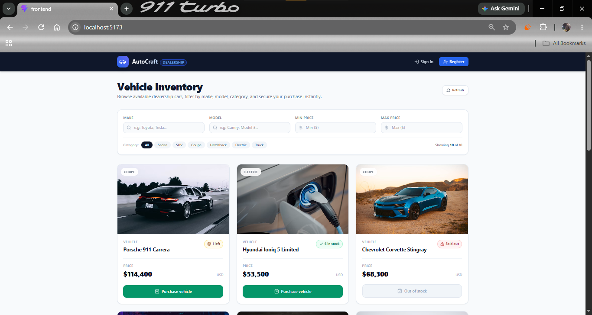

# AutoCraft — Car Dealership Inventory System

A React/Express/MongoDB inventory application for the Incubyte Software Craftsman Internship assessment. The existing architecture and all 15 historical Git commits are preserved. The October 25, 2026 fixes and evidence are uncommitted pending owner review.

## Features and architecture

- Public registration/login, bcrypt password hashing, JWT sessions, and server-enforced customer/admin roles.
- Vehicle CRUD and literal, case-insensitive make/model search, exact category search, and inclusive price ranges.
- Atomic purchases: one unit per request, no purchase at zero stock, and no overselling in the tested concurrent-purchase scenario.
- Admin-only creation, editing, deletion, and positive-integer restocking.
- Responsive inventory UI, customer/admin navigation, accessible labeled dialogs, loading/error/empty states, and session-expiry handling.
- React components/context/API client → Express routes/middleware/controllers → services → Mongoose models → persistent MongoDB.

| Layer | Technology |
|---|---|
| Frontend | React 19, Vite 8, Tailwind CSS 3 |
| Backend | Node.js, Express 4, Mongoose 8 |
| Authentication | bcryptjs, jsonwebtoken (HS256) |
| Automated tests | Jest/Supertest/MongoDB Memory Server; Vitest/Testing Library |
| Live verification | Normal backend plus disk-backed MongoDB and Chromium browser automation |

## Project structure

```text
backend/src/config/        Environment loading and validation
backend/src/controllers/   Request/response handling
backend/src/middleware/    Authentication, roles, safe errors
backend/src/models/        User and Vehicle schemas
backend/src/routes/        Auth and vehicle endpoints
backend/src/services/      Authentication and inventory logic
backend/src/validators/    Request input validation
backend/src/scripts/       Admin/catalog seeds and legacy mock
backend/tests/             Integration and regression tests
frontend/src/components/   Inventory, filters, navigation, dialogs
frontend/src/context/      Authentication state
frontend/src/hooks/        Dialog keyboard/focus behavior
frontend/src/services/     HTTP client
frontend/src/tests/        Component, API-client, and application tests
scripts/verify-live.mjs    Reproducible real-stack verification
screenshots/verified/      Actual application and saved-output screenshots
evidence/                  Recorded commands and live-check results
```

## Prerequisites and installation

Use Node.js 24 LTS (this workspace was checked with Node 24.14.0 and npm 11.9.0), npm, and MongoDB. Dependency lockfiles are included.

From the project root, in PowerShell:

```powershell
npm.cmd ci --prefix backend
npm.cmd ci --prefix frontend
```

Tests use their own isolated MongoDB instance, not your application database. The first backend test run may download a MongoDB binary and require network access. A cached Windows MongoDB 7.0.24 binary was available during verification.

## Environment and database setup

Copy `backend/.env.example` and `frontend/.env.example` only when the corresponding `.env` file does not already exist. Preserve existing private settings. Never commit `.env` files.

Backend settings:

| Variable | Meaning |
|---|---|
| `PORT` | API port; default 5000 |
| `NODE_ENV` | `development` locally; `production` requires explicit database and origin settings |
| `MONGODB_URI` | Persistent MongoDB connection; local default `mongodb://127.0.0.1:27017/car_dealership` |
| `JWT_SECRET` | Required unique random secret, at least 32 characters; no fallback |
| `JWT_EXPIRES_IN` | Duration with unit, e.g. `24h` |
| `CLIENT_URL` | Exact browser origin, normally `http://localhost:5173` |
| `INITIAL_ADMIN_NAME` | Administrator display name |
| `INITIAL_ADMIN_EMAIL` | Explicit administrator email |
| `INITIAL_ADMIN_PASSWORD` | Explicit unique password, at least 12 characters and at most 72 bytes; no default |

Generate and store a secret privately; do not share it in transcripts. Example placeholders are not working credentials. Existing `.env` files were preserved during remediation. The final scan found current private credential values in historical README revisions (`91e38d1`, `fc7b4a6`, `90f8ef0`), while finding no exact private-value matches in current publishable text files. Rotate affected credentials privately before any publication or external use. History was deliberately preserved; its sensitive values were not printed in the review.

Frontend: `VITE_API_BASE_URL=http://localhost:5000/api`. Never put secrets in frontend environment variables.

Start a persistent MongoDB service/instance or configure your own Atlas URI. On this Windows workspace, the cached binary can also run a persistent local database in a separate terminal, from the project root:

```powershell
New-Item -ItemType Directory -Force .local-verification/development-db | Out-Null
& ./backend/node_modules/.cache/mongodb-memory-server/mongod-x64-win32-7.0.24.exe --dbpath .local-verification/development-db --bind_ip 127.0.0.1 --port 27017
```

This is the real MongoDB executable with a disk data directory, not the mock application server. The command requires that cached binary; otherwise install/start MongoDB through your usual local setup. Do not stop or replace another process already using the port.

## Start the application

After setting private backend configuration:

```powershell
cd backend
npm.cmd run seed:admin
npm.cmd run seed:vehicles
npm.cmd start
```

In another terminal:

```powershell
cd frontend
npm.cmd run dev
```

Open `http://localhost:5173`. The API binds to loopback. `/api/health` returns 200 only while Mongoose reports connected; it returns 503 when disconnected. Startup refuses to listen if the database connection fails. Connection-loss detection follows MongoDB driver monitoring, not an instantaneous per-request ping.

Admin seeding refuses missing/placeholder credentials and refuses to promote an existing customer silently. An existing administrator is left unchanged. Vehicle seeding skips a nonempty catalog. Public registration always creates a customer, regardless of a submitted role.

**Legacy mock:** `npm run demo` starts the old non-persistent mock on loopback port **5001**, explicitly labeled mock-only and blocked in production. It has fake authentication and incomplete admin operations. Do not point the assessment UI at it or use it as persistence/authentication evidence.

## Tests and verification

```powershell
npm.cmd test --prefix backend
npm.cmd run test:coverage --prefix backend
npm.cmd test --prefix frontend
npm.cmd run lint --prefix frontend
npm.cmd run build --prefix frontend
```

Current observed results and coverage scope are in [TEST_REPORT.md](TEST_REPORT.md), with original saved output under [evidence](evidence/). Tests generate an ephemeral signing secret and do not read your private application `.env`.

Live verification uses dedicated ports 27028/5055/5175, a new ignored disk database directory, random process-only credentials, and the normal `backend/src/server.js`. It never modifies your existing application database or environment files. It stops its own processes afterward and retains its database files:

```powershell
# Optional: point these at locally installed executables/packages if needed.
$env:MONGOD_BINARY = 'C:\path\to\mongod.exe'
$env:PLAYWRIGHT_MODULE = 'C:\path\to\node_modules\playwright'
node scripts/verify-live.mjs
# API/persistence checks without browser automation:
node scripts/verify-live.mjs --api-only
```

Chrome and Playwright must be available for browser capture. No new browser dependency is added to the application. The script defaults to this workspace's cached MongoDB binary if `MONGOD_BINARY` is unset. The two saved test-output screenshots additionally require the saved backend/frontend logs under `evidence/`. Logs are refreshed by running checks and saving their output, not by inventing a report.

## API reference

All paths below are relative to `/api`. Successful lists return `{ vehicles }`; mutations return `{ message, vehicle }` (deletion returns `{ id, message }`). Authentication returns `{ user, token, message }`. Errors return `{ message }` without stack traces or arbitrary internal details.

| Method | Path | Access |
|---|---|---|
| GET | `/health` | Public readiness |
| POST | `/auth/register` | Public |
| POST | `/auth/login` | Public |
| GET | `/auth/me` | Authenticated |
| GET | `/vehicles` | Public |
| GET | `/vehicles/search?make=&model=&category=&minPrice=&maxPrice=` | Public |
| GET | `/vehicles/:id` | Public |
| POST | `/vehicles` | Admin |
| PUT | `/vehicles/:id` | Admin |
| DELETE | `/vehicles/:id` | Admin |
| POST | `/vehicles/:id/purchase` | Authenticated |
| POST | `/vehicles/:id/restock` | Admin |

Vehicle fields: `make`, `model`, `category` (nonempty text); `price` (finite nonnegative JSON number); `quantity` (nonnegative safe integer). Updates allow only these fields and must not be empty. Restock body: `{ "quantity": 3 }`. IDs must be 24 hexadecimal characters. Invalid inputs return 400, authentication failures 401, role failures 403, missing vehicles 404, duplicate email 409, and database unavailability 503.

PowerShell example (enter credentials privately; token remains in a variable):

```powershell
$base = 'http://localhost:5000/api'
$credentials = Get-Credential -Message 'Enter an existing dealership account'
$body = @{ email = $credentials.UserName; password = $credentials.GetNetworkCredential().Password } | ConvertTo-Json
$session = Invoke-RestMethod "$base/auth/login" -Method Post -ContentType 'application/json' -Body $body
$headers = @{ Authorization = 'Bearer ' + $session.token }
Invoke-RestMethod "$base/vehicles/search?category=SUV&maxPrice=45000"
# Requires an administrator login:
$vehicle = @{ make='Example'; model='Tourer'; category='SUV'; price=32000; quantity=2 } | ConvertTo-Json
$created = Invoke-RestMethod "$base/vehicles" -Method Post -Headers $headers -ContentType 'application/json' -Body $vehicle
Invoke-RestMethod "$base/vehicles/$($created.vehicle.id)/purchase" -Method Post -Headers $headers
Invoke-RestMethod "$base/vehicles/$($created.vehicle.id)/restock" -Method Post -Headers $headers -ContentType 'application/json' -Body '{"quantity":3}'
Invoke-RestMethod "$base/vehicles/$($created.vehicle.id)" -Method Put -Headers $headers -ContentType 'application/json' -Body '{"price":33000}'
Invoke-RestMethod "$base/vehicles/$($created.vehicle.id)" -Method Delete -Headers $headers
```

Registration accepts `{ "name": "Your name", "email": "your@example.com", "password": "<your private password>" }`. Passwords are 6+ characters for registration and at most 72 UTF-8 bytes. Do not use the placeholder literally.

## Screenshots

The previously missing screenshot set is now under `screenshots/verified/`, captured on October 25, 2026 against the real normal backend and disk-backed MongoDB:



| Evidence | File |
|---|---|
| Search/filter with correct total | [02_search_filter.png](screenshots/verified/02_search_filter.png) |
| Login and registration | [03_login.png](screenshots/verified/03_login.png), [04_registration.png](screenshots/verified/04_registration.png) |
| Successful purchase: Toyota stock 8 → 7 | [05_purchase_stock_change.png](screenshots/verified/05_purchase_stock_change.png) |
| Admin inventory and add/edit dialogs | [06_admin_inventory.png](screenshots/verified/06_admin_inventory.png), [07_admin_add.png](screenshots/verified/07_admin_add.png), [08_admin_edit.png](screenshots/verified/08_admin_edit.png) |
| Restocking and resulting stock | [09_admin_restock.png](screenshots/verified/09_admin_restock.png), [10_restock_success.png](screenshots/verified/10_restock_success.png) |
| Delete confirmation | [11_admin_delete.png](screenshots/verified/11_admin_delete.png) |
| Mobile viewport (390 × 844) | [12_mobile.png](screenshots/verified/12_mobile.png) |
| Actual saved command output displayed in browser | [13_backend_test_output.png](screenshots/verified/13_backend_test_output.png), [14_frontend_test_output.png](screenshots/verified/14_frontend_test_output.png) |

The original `screenshots/01_inventory_dashboard.png` is retained as historical **mock-server** evidence only. It does not prove real authentication or persistence. See [screenshots/README.md](screenshots/README.md) for provenance.

## Assumptions and limitations

- Registration and browsing are public. All inventory changes except purchases require admin access; customers can purchase.
- A purchase is an immediate single-unit stock decrement, without payment processing, order history, or request idempotency. Separate successful requests represent separate sales.
- Admin deletion with remaining stock is allowed, with a UI warning. Currency is USD.
- JWTs are stored in browser localStorage; logout removes the local session. Server-side revocation/role-change invalidation, rate limiting, and production operations hardening are not implemented.
- Totals are fetched separately from filtered results; simultaneous external writes can momentarily change the count. No pagination is implemented.
- Automated accessibility checks cover labels and basic keyboard/focus behavior, not a full accessibility certification.
- The original assessment attachment is not present. Exact external rubric compliance, required AI attribution identity, and acceptance of any prompt-export format remain unverified. See [ASSESSMENT_CHECKLIST.md](ASSESSMENT_CHECKLIST.md).
- No remote is configured, and nothing has been published, pushed, deployed, or submitted. Deployment remains optional per the recorded project prompt.

## TDD evidence

Four historical backend test-before-implementation commit pairs are present: `ee80bf3/f716ba5`, `0aa5be2/7a0bdaf`, `f8f146f/26e5351`, and `fcd6f65/9a78e83`. Some initial RED runs failed on missing imports. Frontend tests and implementation entered together in `263bd38`; this is not proof of test-first frontend development. The current regression work observed failures before fixes (backend validation/error cases and four frontend cases), then ran passing checks. No retroactive commits or fabricated TDD history were created.

## My AI Usage

The historical project logs identify Google Antigravity as an implementation assistant. Existing commits contain its co-author trailer; the exact underlying model and the assessment's required attribution identity have not been independently verified.

OpenAI Codex assisted with the October 25 audit and remediation: backup, configuration/security fixes, validation, frontend corrections, regression tests, real-stack browser verification, screenshots, and documentation. Tool outputs and saved evidence support the test claims. No new commits were made. This document does not assert that the owner has personally reviewed or understood every change; that review remains the owner's responsibility.

[PROMPTS.md](PROMPTS.md) contains a curated historical prompt extract and explicit provenance/omissions. The preserved private `conversation_transcript.jsonl` is ignored because it includes internal system/tool material and may contain sensitive local information. It must not be uploaded blindly. A complete, suitable conversation export or genuine share link should be reviewed against the original assessment before submission.
